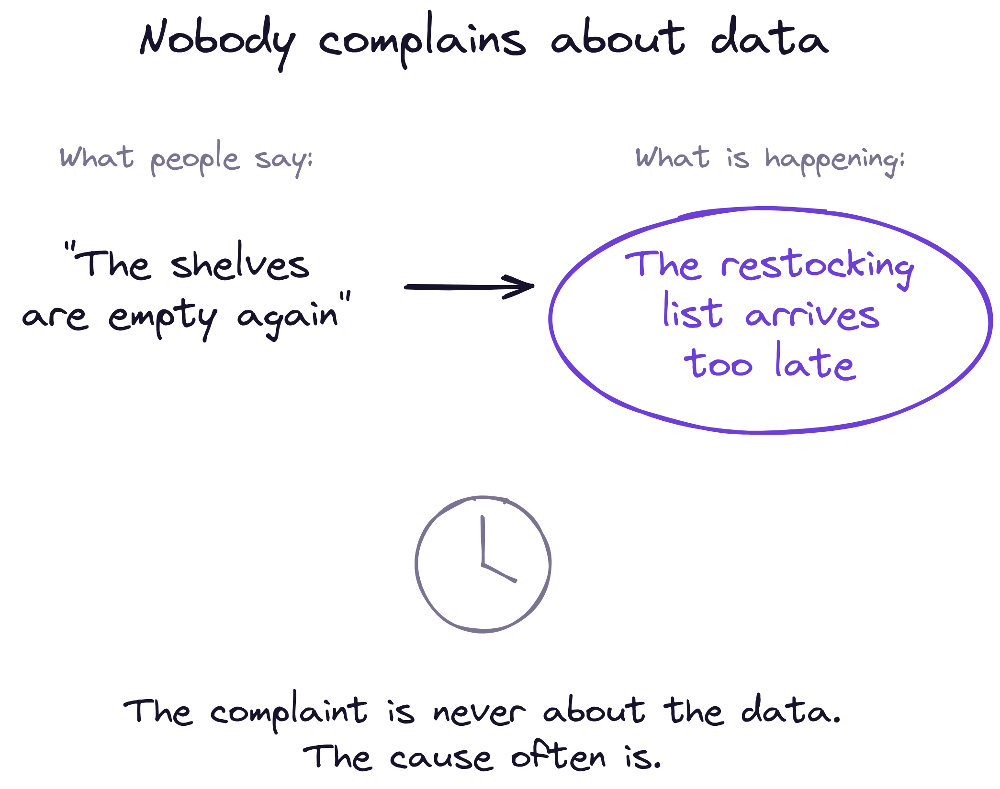
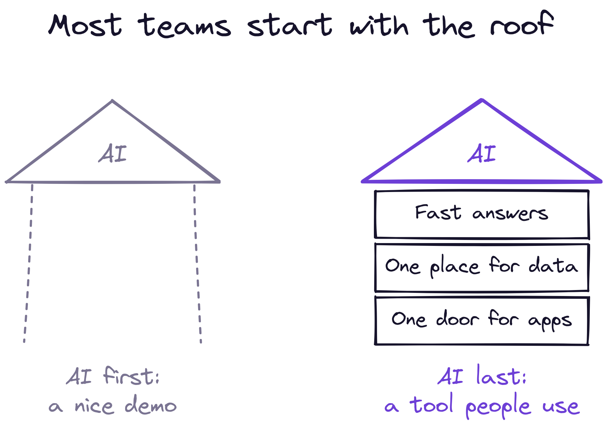
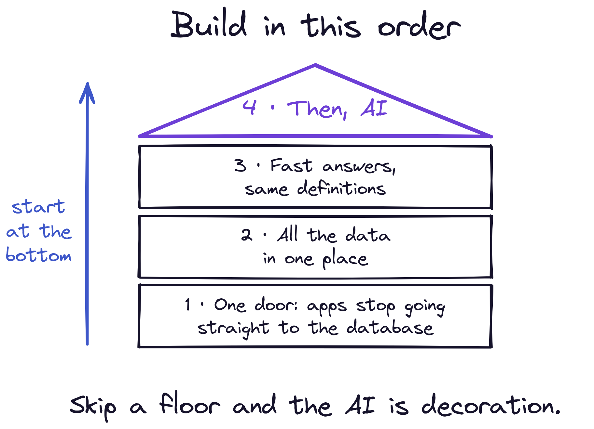
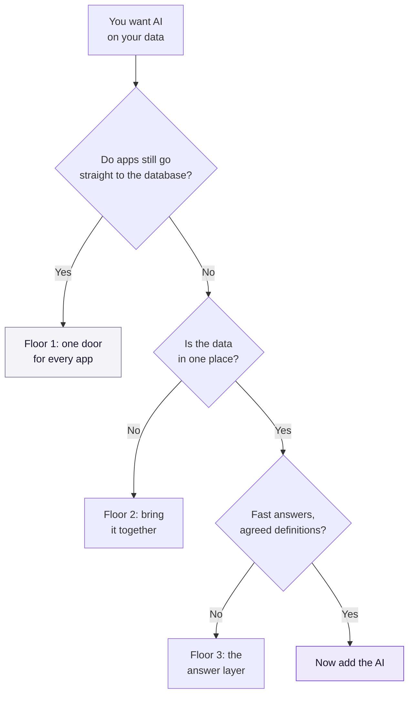

Everyone wants the AI first. It should be the last thing you build.

That sounds backwards when every vendor demo starts with a chat box answering questions about your business. So let me explain with a problem that, on the surface, has nothing to do with AI or data.

## Nobody complains about data

Picture a regional supermarket chain.

Every morning some stores open with gaps on the shelves. The warehouse has the stock. The trucks are running. But the list telling the warehouse what each store needs arrives too late to load the first delivery.

So people look at the warehouse, the drivers and the store managers. Nobody looks at the list.

The list is late because the information it needs is scattered. Yesterday's sales sit in the tills' system, the stock in the warehouse's system and the promotions in a spreadsheet. Each application fetches what it needs on its own, slowly, and the list can't be finished until all of them have.

Nobody opens a ticket that says "our data is badly organised." They open one that says "the shelves are empty." Translating the second sentence into the first is the real work.

## The tempting shortcut

Now imagine the chain's answer is to buy an AI assistant that predicts what each store will need. It's the visible part, it demos well, and it feels like progress.

But an AI can only be as fast and as right as the data underneath it. Put it on top of slow, scattered data and it doesn't fix the mess. It repeats the mess, faster and with more confidence. And because it sounds sure of itself, people believe it for longer.

Think of a house. The AI is the roof. It's the part everyone sees, and it's the last thing you build.

## The order to build in

There are three floors under that roof. They go in from the bottom up.

**1. One door for every application.** In many companies, each application goes straight to the database (the place where records are kept) with its own hand-written request. The first floor is to stop that. Every application asks through one shared entrance instead. Engineers call it an API, which is simply an agreed way for one program to ask another for something. This matters more than it sounds. As long as any application can go around the door, everything you build behind it is optional, and someone will skip it by Tuesday.

**2. One place for the data.** Sales lives in one system, stock in another, marketing in a third. The second floor brings them together, so a question can be asked across the whole business instead of inside one department.

**3. Fast answers with agreed definitions.** On top of that goes a layer with two jobs. It keeps the answers to common questions ready in advance, so they come back in a moment instead of after a coffee. And it holds one definition of each business term, so "revenue" or "active customer" means the same thing every time someone asks.

**4. Only then, the AI.** Now the assistant has something reliable to read. It doesn't touch the raw databases. It asks the same fast, agreed layer everything else uses, which means it can only give the answer the business already agreed on.

## Each floor pays for itself

The usual objection is that this sounds like years of plumbing before anyone sees a benefit. It isn't, because each floor is useful on its own.

| Floor | What it is | What you get before any AI |
|---|---|---|
| **1. One door** | Applications ask through a shared entrance | You can change a system without breaking five others |
| **2. One place** | Data from every system, together | Questions that cross departments become possible |
| **3. Fast, agreed answers** | Ready-made answers and one definition per term | Reports load quickly and everyone reads the same number |
| **4. The AI** | An assistant that reads from floor 3 | People ask in plain language and get the agreed answer |

Go back to the supermarket. With the first three floors in place, the restocking list is ready before the first truck is loaded, and the shelves are full at opening time. No AI was involved, and the problem everyone was complaining about is gone. The AI on top then becomes useful for the next question, such as what to order before a holiday weekend, because it finally has something reliable to read.

I've written before that [the foundation matters more than the features](https://mcorte.com/posts/building-ai-agents-that-actually-work/) when you build with AI. This is the same argument applied to company data.

## Where is your company on this?

If you're thinking about putting AI on top of your company's data, here's the test I'd run first:

A lot of companies are on floor one or two and shopping for a roof. If that's you, it isn't bad news. It tells you where the next piece of work is, and that work will pay off whether or not you ever add an AI.

## Conclusion

The AI is rarely the hard part. The hard part is the order.

Start with the AI and you get something that impresses in a meeting and disappoints in a month. Start with the floors and the AI becomes the simplest step, because by then it has something solid to stand on.

**Takeaways:**

- **Find the delay that isn't called a data problem.** Empty shelves, slow quotes, late deliveries. Follow it back to where the information comes from.
- **Close the side entrances first.** While applications can go straight to the database, nothing you build on top will hold.
- **Bring the data together before you ask questions across it.** An AI can't connect systems that have never met.
- **Agree what your words mean, once.** One definition of each term, kept in one place.
- **Add the AI last, and point it at the agreed layer,** never at the raw databases.

What's the delay in your company that nobody has traced back to the data?
