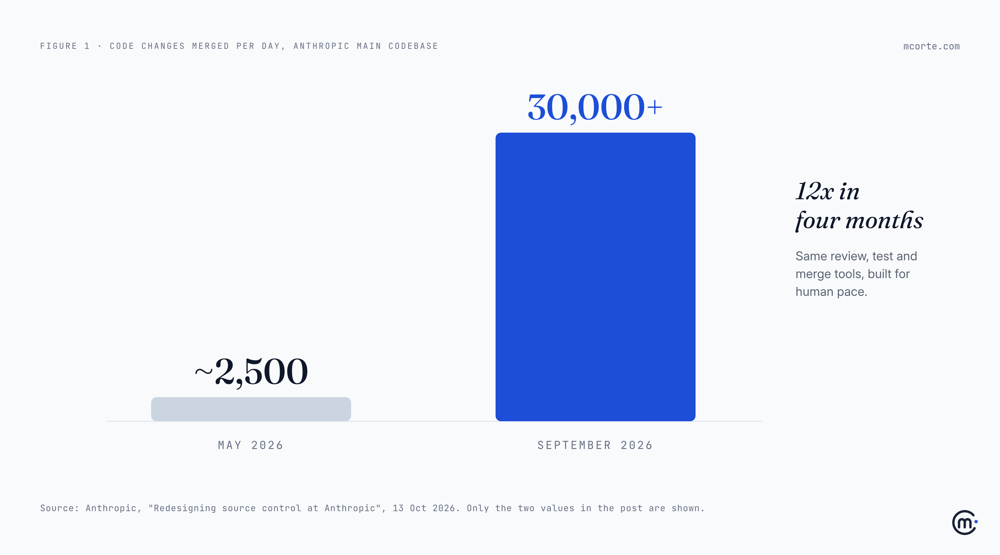
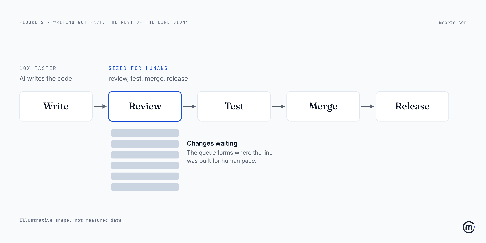

On 13 October, Anthropic published something I didn't expect to read in 2026: it has [moved its main codebase off Git](https://www.anthropic.com/engineering/redesigning-source-control).

Not because Git is bad. Because of a number. In May, about 2,500 code changes a day were merged into that codebase. By September, it was over 30,000. The growth came from AI agents writing, testing and checking code. The tools that keep track of all that were built for people.

Most of the headlines were about Git. I think they missed the point. The interesting sentence in Anthropic's post is this one:

> "The bottleneck, now, is all of the developer infrastructure built for human scale: source control, builds, and CI."

You are almost certainly not Anthropic. You don't need to build your own version control, and you shouldn't. But if your teams are using AI to write code, that sentence is already about you. You just haven't hit the wall yet.

## What actually happened

Here is the short version, in plain words.

Git was designed for a world where every developer keeps a full copy of the code on their own machine and works offline. That's a great design for people. It's a poor one for thousands of AI agents and automated jobs that are always online and only need a small part of the code each time.

Anthropic's codebase got so big and so busy that keeping it on Git took several hundred copies of the repository just to keep up, plus a pile of workarounds. The test system alone was checking out the code about 25 million times a day. So a team of seven engineers spent five months building a replacement, called Scion, and a new code review tool alongside it.

The results they report: checkouts in seconds instead of minutes, about 200 times less computing power than the old setup, and a quarter of their testing system's computing capacity freed up. They also say clearly that Scion is not a general replacement for Git, and they don't plan to release it.

## The checkout, not the shelves

Think of a supermarket. For years, the slow part was stocking the shelves. Then someone invents a machine that fills the shelves ten times faster. Great news, until you look at the front of the store. There are still three checkouts and three cashiers, and the queue reaches the bread aisle.

AI coding tools are that machine. They fill the shelves. Writing code was the slow, expensive part of software for fifty years, so everything around it was sized for that pace: how we review changes, how we test them, how we merge them, how we approve a release.

When writing gets ten times faster, the work doesn't disappear. It moves to the checkout. And the checkout was designed for humans.

## Where the queue forms in a normal company

You won't see 30,000 merges a day. But you'll see the same pattern at a smaller scale, usually in this order:

| Step | Built assuming | What happens when AI writes 3–5x more | What to change |
|---|---|---|---|
| Code review | A person reads every line | Seniors drown, or start approving without reading | Review by risk: humans check intent and sensitive code, machines check the rest |
| Automated tests | A few changes an hour | Test queues grow, the bill grows | Run the tests that matter for each change, budget the rest |
| Merging | Few, slow, large changes | More conflicts, more broken builds | Smaller changes, merged more often |
| Release approval | A weekly meeting | The backlog waits for Thursday | Approve the rules once, not every change |
| Ownership | Whoever wrote it understands it | Code nobody fully wrote, or fully knows | One named owner per area, AI-written or not |

Anthropic's own answer on review is worth noting. Their engineers still review every change, but they focus on the *intent* of the change rather than reading every line. Their review tool can tell a change that only edits comments from one that touches sensitive logic, and treat them differently. And the post includes one of the most honest lines I've read about working with AI: "Very often, we found that the role of the engineers was to tell Claude 'no.'"

That's not a technology change. It's a change in what we ask senior engineers to do all day.

## What it looks like in a team of 40

A made-up example, but I've seen versions of it more than once.

A product team of 40 rolls out AI coding assistants. Three months later, the dashboard looks great: twice as many changes opened every week. Leadership is happy.

Then someone asks a different question: are we shipping features to customers any faster? Not really.

When they look, the answer is in the queue. A change now waits two days for review instead of half a day. Four senior engineers spend most of their week reviewing code they didn't write and can't fully follow. Tests take longer because more changes are running through them at once. Nobody decided any of this. It just happened, one reasonable step at a time.

The first instinct is to blame the AI: "it writes too much, and it's sloppy." The real problem is that the team made one part of the line ten times faster and left the rest as it was.

What fixed it wasn't a new tool. They split reviews into two lanes: low-risk changes checked by automated rules and a quick look, sensitive changes (payments, permissions, data) read in full by a senior. They asked for smaller changes. And they started tracking one number every week: how long a change waits between "ready" and "merged".

## The leadership part

For engineering leaders, this is the real lesson of Anthropic's post. Measuring how much code AI produces is the wrong number. Lines written, changes opened, "percentage of code generated by AI": all of those measure the shelves.

The number that matters is how long finished work waits before it reaches a customer. If AI made writing faster and that number didn't move, you didn't get faster. You just moved the queue.

It also changes the job of your best engineers. The scarce skill is no longer writing code quickly. It's judging, quickly and well, whether a change should exist at all. That deserves to be planned for, trained and recognised, not squeezed in between meetings.

## What to do this week

- **Measure the wait.** For the last month: how long does a change sit between "ready for review" and "merged"? Has it grown since your team started using AI?
- **Count the review load.** How many hours a week do your most senior people spend reviewing? Is that a choice or an accident?
- **Split review by risk.** Decide which areas a human must always read in full. Let rules and automated checks handle the rest.
- **Ask for smaller changes.** Many small changes move through the line faster than a few big ones, for people and for AI.
- **Stop celebrating output.** Report time to customer, not code produced.

## The uncomfortable question

If your team's code output doubled next month, where would it wait first? And do you know, or would you find out from a delivery date you missed?

**Takeaways:**

- **The bottleneck moved.** Writing code is no longer the slow part. Review, testing, merging and release approval are.
- **Your delivery line was sized for humans.** Most teams sped up one step and left the rest as it was.
- **Don't build your own Git.** Do measure how long finished work waits, and fix the step where it waits longest.
- **Review intent, not every line.** Decide where humans must read in full, and let machines check the rest.
- **Measure time to customer, not code produced.** More output with the same delivery speed isn't progress.

*Working through this with your team? I'm always happy to compare notes: hello@mcorte.com*
