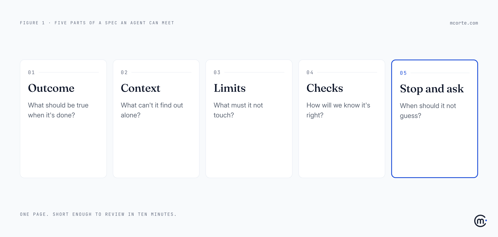
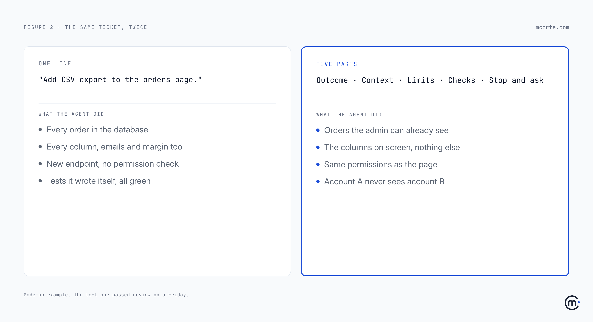

Every few weeks someone shows me a pull request an AI agent opened and says: "See? It still can't code."

Then I read the ticket that started it. Most of the time it's one line.

The agent didn't code badly. It did exactly what that line said, and it guessed everything else. The guesses are what broke.

Last week I wrote about [Anthropic moving its main codebase off Git](https://mcorte.com/posts/anthropic-outgrew-git-your-bottleneck-is-next/), after daily merges went from about 2,500 to over 30,000 in four months. When writing code gets that cheap, quality is decided in two places: what you send in, and what you review on the way out. Last week was about the way out. This week is about the way in.

## Leaving the kids with a babysitter

When you leave your kids with a babysitter for the evening, you don't hand over twenty pages. You also don't say "look after them" and walk out the door.

You say four or five things. Dinner at seven, bed at eight-thirty. No screens after dinner. The little one is allergic to nuts. If anything happens, call me, not your mum. And when you get back, you know in ten seconds whether it went well: everyone asleep, kitchen standing.

That's a spec. Short, specific, and built around the things a smart person who has never been in your house can't possibly guess.

An AI agent is that smart person who has never been in your house. Every single time.

## What a spec is not

Two things people get wrong, in opposite directions.

The first is the one-line ticket: "Add CSV export." Fine for a colleague who has sat next to you for three years. Useless for anyone who hasn't.

The second is the overcorrection: a 14-page requirements document, or a prompt so long nobody reads it, including the agent. Thoughtworks put *spec-driven development* in the [Assess ring of its Technology Radar](https://www.thoughtworks.com/radar/techniques/spec-driven-development) and was refreshingly blunt about this. It notes that "the workflows remain elaborate and opinionated", that some tools "generate lengthy spec files that are hard to review", and then: "We may be relearning a bitter lesson — that handcrafting detailed rules for AI ultimately doesn't scale."

I agree with that warning. The answer to vague tickets is not waterfall with a chatbot. It's a short spec that a human can review in ten minutes and a machine can check.

## The five parts

1. **Outcome.** What should be true when it's done, in one sentence. Who gets what, and why. Not the implementation: the result.
2. **Context.** What it can't find out alone. Where the data lives, which existing piece to reuse, the customer who complained, the odd rule that looks like a bug but is on purpose.
3. **Limits.** What it must not touch. Data it shouldn't expose, permissions it shouldn't change, files and services that are off limits, no new dependencies.
4. **Checks.** How you'll know it's right. A test, an example input with its expected output, a number ("loads in under two seconds"). If you can't write the check, you're not ready to hand the work over.
5. **Stop and ask.** When it should not guess. Missing data, a change that would cross a limit, two reasonable readings of the same sentence. This is the line people skip, and the one that saves the most time.

| Part | The question it answers | What happens when it's missing |
|---|---|---|
| Outcome | What should be true when it's done? | The agent solves a neighbouring problem, beautifully |
| Context | What can't it find out alone? | It rebuilds something you already have, or "fixes" a rule that was on purpose |
| Limits | What must it not touch? | It changes things nobody asked about: data, permissions, dependencies |
| Checks | How will we know it's right? | It writes its own tests, and they pass |
| Stop and ask | When should it not guess? | It guesses, confidently, and you find out in review or in production |

## The same ticket, twice

A made-up example, but you will recognise it.

The ticket says: *"Add CSV export to the orders page."*

The agent does a reasonable job of what it was told. It exports every order in the database, with every column, including customer emails and the internal margin field. It adds a new endpoint and, because nothing said otherwise, doesn't check who's calling it. It writes tests for the export, and they all pass, because it wrote them. Each decision makes sense on its own. Together, they are a data leak with a green pipeline.

Now the same request with the five parts:

- **Outcome:** account admins can download, as CSV, the orders they can already see on the Orders page, so finance stops copying tables by hand.
- **Context:** the page already filters by account and date; reuse that query. Finance opens the file in Excel, so dates go as YYYY-MM-DD.
- **Limits:** same permissions as the page. Only the columns shown on screen; never the margin or customer emails. No new dependencies, no database changes.
- **Checks:** an admin of account A never gets a row from account B (there's a test for it). An export of 50,000 rows finishes without timing out. The header row matches the screen.
- **Stop and ask:** if the existing query can't be reused as it is, or if any column needs data from another service.

That's eleven lines. It took ten minutes to write. The pull request that came back was smaller, and the review took ten minutes instead of an hour, because the reviewer had five things to check against instead of a feeling.

## For leaders: review the spec, not just the PR

If your teams are using agents, here's the shift I'd ask for.

**Put senior time before the code, not only after it.** A senior engineer reading a spec for ten minutes catches the problems that would otherwise take an hour to find in a diff. Most teams do the opposite: juniors write a line, the agent writes 400, and the senior reads all 400.

**Make the five parts the ticket template.** Not a new tool. Five headings in the tracker you already use. When one is empty, that's a conversation, not a blocker.

**Treat "stop and ask" as a feature.** An agent that comes back with a question is doing its job. If your process punishes questions ("just get it done"), you will get guesses.

This isn't only for engineering teams. If you're a founder without a technical team, "talking" to an agent to build your product, the five parts are the difference between a demo that works on Tuesday and a product you can trust with customer data.

## What to do this week

- **Rewrite your next three agent tickets** with the five parts. One page maximum.
- **Add the five headings** to your ticket template.
- **Ask reviewers to read the spec first** and the code second.
- **Look at the last five agent PRs you threw away.** Read the ticket behind each one. I'd bet most of the problem is there.
- **Keep it short.** If the spec is longer than the change, the change is too big. Split it.

## The uncomfortable question

If you gave your last ticket to someone on their first day, with nobody around to ask, would they get it right?

If the answer is no, the agent never had a chance either.

**Takeaways:**

- **Agents do what you say and guess the rest.** Most "bad AI code" is a good answer to a vague question.
- **A spec is five short things, not a long document:** outcome, context, limits, checks, and when to stop and ask.
- **Short beats complete.** A spec you can review in ten minutes is worth more than one nobody reads.
- **Move senior time earlier.** Ten minutes on the spec saves an hour on the pull request.
- **Reward the question.** An agent that stops to ask is safer than one that guesses confidently.

*Working through this with your team? I'm always happy to compare notes: hello@mcorte.com*
