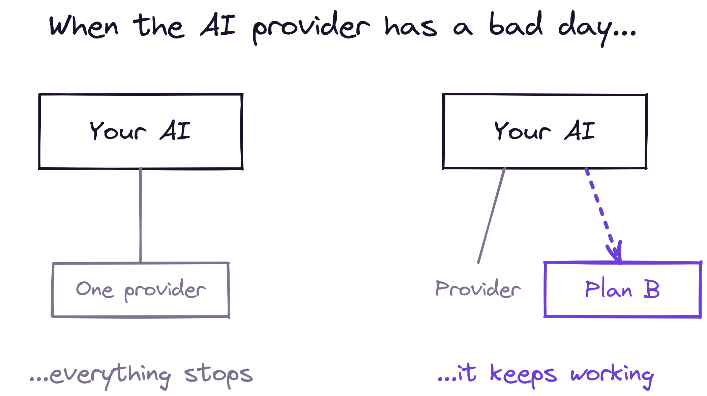
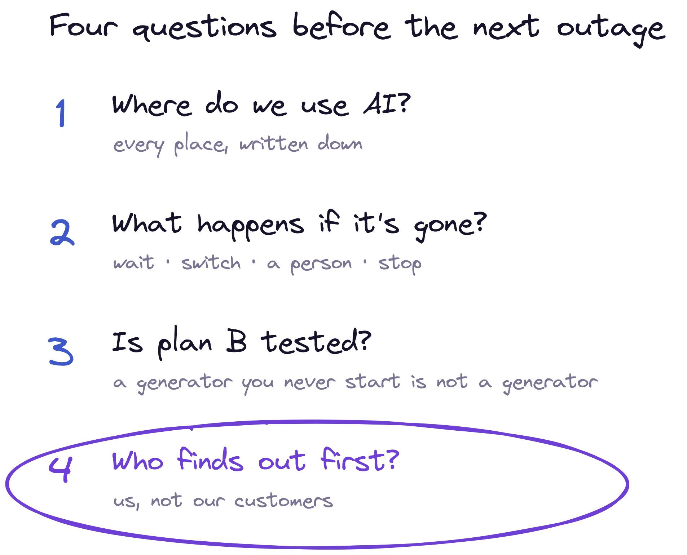
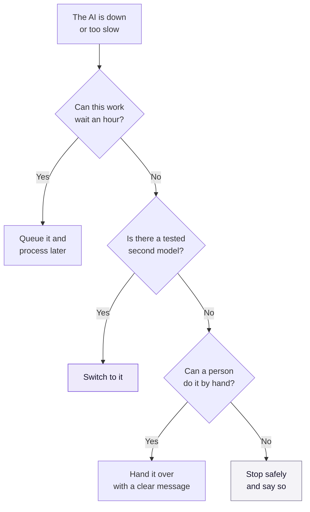
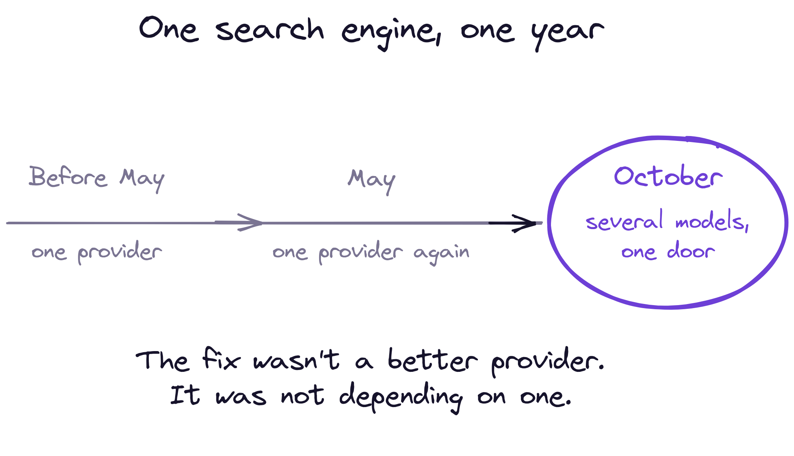

On 6 October, OpenAI's status page logged nine separate incidents in a single day. Errors in ChatGPT, in Codex, in the API that other companies build on, in logins. When I checked it this week, it listed 25 incidents since the start of the month, and one of them was still open.

This isn't a post about OpenAI. Every provider has days like that. On Thursday 3 September, [ChatGPT, Claude and Grok all had trouble on the same morning](https://www.computerworld.com/article/4218388/chatgpt-claude-and-grok-all-went-down-at-once-enterprises-need-a-backup-plan.html): Claude for about four hours, Grok for about three and a half, ChatGPT for about two.

It's a post about the question those days raise, and that most companies I talk to haven't answered:

**When the AI your business runs on has a bad day, what does your business do?**

## You plugged into a power line and forgot about the generator

Think about electricity. A hospital doesn't trust the grid less than you do. It simply knows the grid will fail one day, so it has a generator, it knows which rooms must stay lit, and it tests the generator before it needs it.

Most companies have plugged their AI into a single provider the way you plug a lamp into the wall. One cable. No generator. Nobody decided what should keep working if the power goes.

That was fine when AI was an experiment on the side. It stops being fine the moment it answers your customers, reads your invoices or helps your people make decisions. At that point the AI provider is a supplier your operation depends on, as real as your bank or your electricity company. It just doesn't feel like one, because it arrives through a few lines of code instead of a contract on someone's desk.

## "Down" is the easy case

When the provider is completely down, at least everyone notices. The harder case is the one the status pages describe most often: *degraded performance*, *elevated errors*, *delayed responses*.

In plain words: the AI still answers, but slowly, or only some of the time, or not quite as well as yesterday. Nobody gets an alarm. A customer waits forty seconds for a reply and gives up. An automated step quietly fails one time in ten, and the work piles up somewhere nobody is looking.

In factories, this is old news. Nobody on a production line asks whether a machine will ever lose power or lose its connection. They ask a different question: **what does it do when it does?** Every machine has a defined safe state. It stops in a known position, it raises a signal, and a person knows what to do next. That answer is written down before the line ever runs.

Most AI features today have no safe state. They were designed for the day the model answers.

## Four questions before the next bad day

You don't need a big programme to fix this. You need to answer four questions, in this order.

**1. Where do we use AI?** Write down every place your business sends a request to an AI model: the customer chat, the document search, the invoice step, the sales tool someone built in a weekend. You can't protect what you haven't listed. Most teams are surprised by how long the list is.

**2. What should happen if it's gone?** For each place on the list, pick one of four answers:

- **Wait.** The work can be queued and done later. Invoices can usually wait an hour.
- **Switch.** Send the request to a second model or provider. This is your generator.
- **Hand it to a person.** Show a clear message and route the work to someone who can do it by hand.
- **Stop safely.** For anything risky, stop and say so, instead of guessing.

The wrong answer is the one most systems give by default: an error message, or a spinning wheel, and nobody told.

**3. Is plan B tested?** A generator you never start is not a generator. If your plan B is a second provider, send it a small share of real requests every week, so you know it still works and you know how its answers differ. If your plan B is a person, make sure that person still knows how to do the job without the AI. That skill fades faster than anyone expects.

**4. Who finds out first?** If your customers notice before your team does, you're relying on complaints as your alarm. Measure it yourself: how long each answer takes and how often requests fail, compared with a normal day. Don't wait for the provider's status page. It's usually the last to know.

## What this looks like in practice

Here is the same exercise for four common uses. Your answers may differ; what matters is that each one has an answer.

| Where the AI is used | If the AI stops | Plan B |
|---|---|---|
| Customer support chat | Customers wait, then leave | Say so on screen and pass the conversation to a person |
| Internal document search | People can't find answers | Fall back to the old keyword search |
| Reading invoices | Work piles up unseen | Queue them and process when it's back, with an alert if the queue grows |
| A check on the factory floor | Bad parts could pass | Stop safely and switch to manual inspection |

And here is the decision, for any single use:

## One company that had to answer it twice

Last week the search engine Ecosia [replaced the AI behind its answers](https://technode.com/2026/10/09/ecosia-switches-from-mistral-to-open-weight-ai-models-including-qwen-glm-and-kimi/). It had moved from OpenAI to Mistral in May. Five months later it moved again, citing recurring technical problems, including overloaded servers.

What caught my eye isn't who they left. It's what they did the second time. Instead of picking another single provider, they moved to a set-up that gives them access to several models through one platform. In other words, they stopped betting the product on one supplier.

You don't have to go that far on day one. But it's the direction an analyst at Info-Tech Research Group pointed to after the September outage: treat the model as a "commodity that can be hot-swapped with an alternative". That only works if you built a door between your product and the model, so that changing what's behind it doesn't mean rewriting what's in front of it. I made a similar argument about company data [last week](https://mcorte.com/posts/ai-layer-is-the-last-thing-you-build/): one door, and everything goes through it.

## The cost of not deciding

None of this is expensive compared with the alternative. A list, a decision per use, a monthly test and a simple measure of how long answers take. A few days of work for most teams.

The alternative is deciding in the middle of an outage, with customers waiting, which is the worst possible moment to design anything.

The AI is rarely the hard part. Keeping it useful on a bad day is.

**Takeaways:**

- **Treat your AI provider as a supplier, not a feature.** Your business depends on it as much as on your bank or your power company.
- **List every place you use AI.** You can't protect what you haven't written down.
- **Give each one a safe state:** wait, switch, hand to a person, or stop safely. Never "error and silence".
- **Test plan B before you need it.** A second provider you've never used, or a manual process nobody remembers, is not a plan.
- **Find out before your customers do.** Measure response time and failures yourself; the provider's status page is the last to know.

If your AI provider went dark for four hours tomorrow morning, who would find out first: your team, or your customers?
