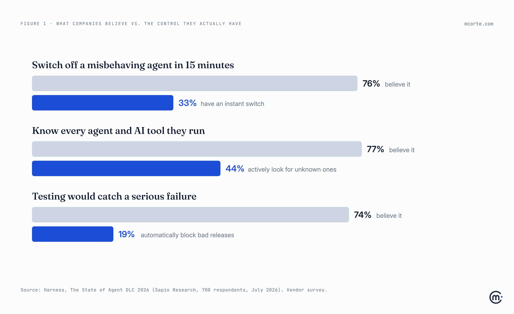
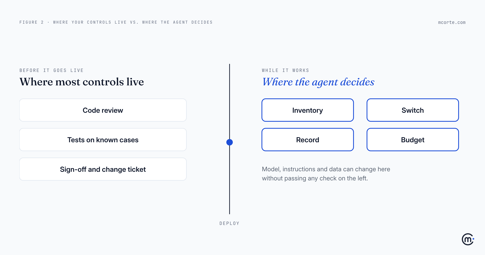

Your AI agent passed every check your company has. Code review. Tests. A security sign-off. A change ticket with three approvals.

That's the problem.

Those checks were designed for software that does the same thing every time. You look at it once, before it ships, and what you approved is what runs. An agent doesn't work like that. It decides while it works: which tool to use, what to tell the customer, when to stop. The decision you most need to control happens *after* every one of your checks has already said yes.

## The gap, in four numbers

In September, Harness published [*The State of Agent DLC 2026*](https://www.harness.io/press-and-news/new-report-reveals-ai-agent-confidence-gap), a survey Sapio Research ran in July among 700 technology professionals at large companies in the US, UK, France, Germany and India. Every one of those companies already had agents in production, in a pilot or in a live proof of concept. These are the committed adopters, not the curious.

Harness sells software in this space, so read it as a vendor report. But the pattern is hard to argue with:

- **76%** believe they could switch off a misbehaving agent in under 15 minutes. **33%** have an instant switch.
- **77%** are confident they know every agent and AI tool they run. **44%** actively look for the ones they don't know about.
- **74%** are confident their testing would catch a serious failure. **19%** have a check that automatically blocks every bad release.
- **74%** say they know what each agent really costs. **60%** went over budget last quarter.

None of this means those teams are careless. It means they're measuring their agents with the ruler they already had. And that ruler was made for something else.

## A driving test is not a black box

Passing your driving test tells you someone can drive on a Tuesday morning, in good weather, with an examiner in the passenger seat. It tells you nothing about how they drive at three in the morning, alone, in the rain. That's why cars also have mirrors, brakes and, more and more, a black box.

Most release controls are the driving test. Code review reads the code. Tests check that known inputs give known outputs. Sign-off confirms that someone looked. All of it happens before the software goes live. For ordinary software that's enough, because what passed the test is what runs.

An agent's behaviour comes from more than its code. It comes from the model underneath, the instructions it was given, the data it reads that day and the tools it can reach. Change any one of those and the behaviour changes, often without anything passing through your release process. The same report found that only 42% of companies send changes to an agent's instructions through the same pipeline as a code change. In most companies, someone can change what an agent does by editing a paragraph of text, and none of the checks will see it.

## Four controls that reach the agent

You don't throw the old checks away. You add four that work while the agent is working.

**1. An inventory.** You can't control what you don't know is running. One list: every agent, what it can touch (systems, data, money), and the one person who owns it. Include the ones a team set up on their own last quarter. Those are the ones that surprise you.

**2. A switch.** One person, one action, and the agent stops within minutes, with somewhere for the work to go: a human queue, a simpler rule, a polite "we'll get back to you". If stopping it needs a deploy, you don't have a switch. If nobody has tried it, you don't know if you have one.

**3. A record.** Enough to rebuild any decision afterwards: what the agent saw, what it decided, which tool it used, which version of its instructions it was following. Not for debugging (I've [written about that before](https://mcorte.com/posts/debug-agents-you-cant-reproduce/)), but to answer the question a customer, an auditor or your CEO will eventually ask: *why did it do that?*

**4. A budget per agent.** A spending limit, an alert well before it, and a named person who gets the alert. A runaway agent usually shows up in the bill before it shows up anywhere else.

Here's how they line up against what you probably already have:

| The control you have | What it checks | What an agent also needs |
|---|---|---|
| Code review | The code, once | Changes to instructions reviewed like code |
| Test suite | Known cases, before release | Real outputs sampled every week, after release |
| Change approval | That someone said yes | A switch someone can pull in minutes |
| Asset register | Servers and licences | A list of agents and what each one can touch |
| Department budget | The total, once a year | A limit and an alert per agent |

## What it looks like when it goes wrong

A made-up example, but a common one.

A mid-sized online shop puts an agent on customer support. It can read orders, answer questions and, for orders under a set amount, issue a refund. It's reviewed, tested and signed off. The first two months go well.

In month three there's a strike at the delivery company, and the support lead updates the agent's instructions: "be generous with customers whose orders are delayed." One sentence. No ticket. The agent reads it its own way: any late order, for any reason, gets a full refund. Including orders that are one day late.

Nobody notices for nine days. Not because people are careless, but because nothing is watching. The tests still pass, because they test last month's cases. The support dashboard shows tickets closed faster than ever, which looks like a win. Finance spots it at month-end, when refunds have tripled.

Then come the questions. How many refunds? Which customers? Since when? Why? Nobody can answer quickly, because the agent's decisions weren't recorded anywhere you could search. And when someone says "switch it off while we figure this out", it takes an afternoon, because switching it off means a deploy and the person who knows how is on holiday.

Now replay it with the four controls. The instruction change gets logged and reviewed. The refund budget alert fires on day two. The support lead switches the agent to a human queue in five minutes. The record tells finance exactly which orders to look at. Same mistake, but a two-day problem instead of a nine-day one, and a calm conversation instead of a crisis.

## What to do this week

- **Ask for the list.** Every agent running in your company, who owns it and what it can touch. Notice how long the answer takes.
- **Find the switch.** For your most important agent: who can stop it, and how long does it take? Then try it on a quiet afternoon.
- **Pick ten decisions.** Take ten things an agent did last week. Can you explain each one without guessing?
- **Put a limit on the bill.** A spending cap and an alert for every agent, with a name next to it.
- **Treat instructions as code.** A change to what an agent is told goes through the same review as a change to what it runs.

## The uncomfortable question

Could you switch off your most important agent today, in under 15 minutes? Who has the button?

If your honest answer is "I think so", you're in the 76%. The question is whether you're also in the 33%.

**Takeaways:**

- **Confidence is not a control.** Most companies believe they can stop, test and price their agents far better than their tools let them.
- **Your checks happen before. The agent decides after.** Controls built for predictable software don't reach the moment that matters.
- **Instructions are code.** If a paragraph of text can change what an agent does, that paragraph needs the same review as code.
- **Add four controls, don't replace the old ones:** an inventory, a switch, a record and a budget per agent.
- **Test the switch before you need it.** A switch nobody has pulled is a hope, not a control.

*Working through this with your team? I'm always happy to compare notes: hello@mcorte.com*
