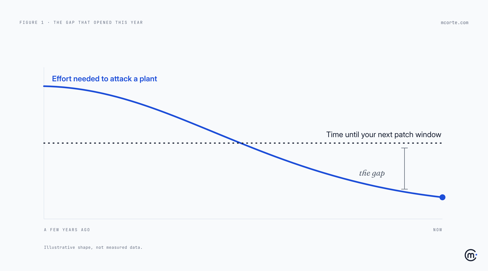
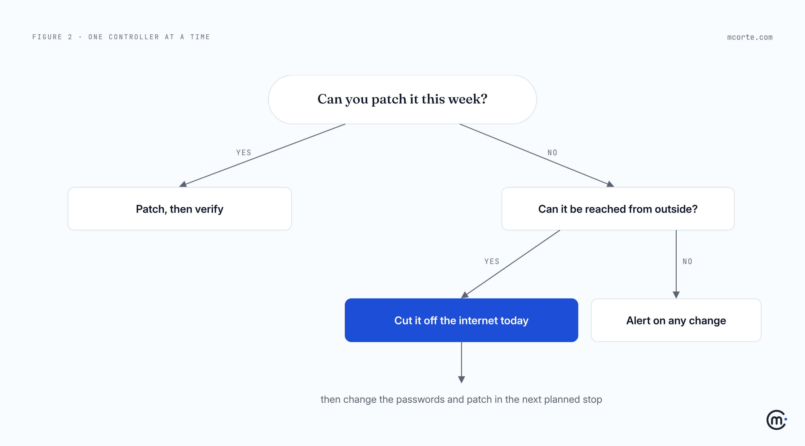

Every plant I've worked around had a security control that appeared in no risk register, no audit and no budget. It was this: **attacking a factory was hard work.**

To hurt a production line you needed someone who understood the controllers, the protocols, the vendor's quirks and the process behind them. People like that are rare. Most of them are busy running factories. That scarcity protected a lot of plants that never noticed they were being protected.

In August, that protection got a lot thinner.

## What the agencies actually said

On 19 August, the NSA, CISA, FBI, the US Department of Energy and the EPA published a joint advisory, [AA26-231A](https://www.cisa.gov/news-events/cybersecurity-advisories/aa26-231a), about active attacks on Siemens S7 controllers: the small industrial computers (PLCs) that run machines in manufacturing, energy, water, chemicals and food.

Read it closely and the attack itself is almost boring. No new vulnerability. No zero-day. The attackers scan the internet for controllers that shouldn't be reachable, log in with default or weak passwords, and run scripts that read and write the controller's memory and programs, [disguised as ordinary monitoring tools](https://industrialcyber.co/industrial-cyber-attacks/cisa-nsa-fbi-warn-of-siemens-s7-plc-exploitation-using-ai-generated-scripts-to-disrupt-critical-industrial-processes/).

What's new is how those scripts were written. The agencies say the attackers used AI to generate them from publicly available information, [in their words](https://securityaffairs.com/197566/ics-scada/nsa-cisa-fbi-doe-and-epa-warn-of-active-ai-assisted-attacks-on-siemens-s7-plcs.html), "dramatically reducing the technical expertise and time required to develop working ICS exploitation scripts."

That sentence is the whole story. AI didn't create a new hole in the wall. It made the existing holes much cheaper to use.

## The defense nobody wrote down

Think of a house in a quiet village with a lock anyone could pick. For years it was never touched, not because the lock was good, but because the people who knew how to pick it lived far away and had better things to do.

Now imagine a video appears that teaches anyone to pick that lock in ten minutes. The lock didn't change. The house didn't change. But the protection the owner was relying on, without knowing it, is gone.

That's where many plants are now. Their real risk model was never "our controllers are secure." It was "nobody capable would bother." Those are very different statements, and only one of them was ever written down.

This matters because of the other side of the equation, the one that hasn't moved at all.

## Your patch window didn't get shorter

In an office, applying a security update is an inconvenience. On a production line, it's a production decision.

Updating a controller can mean stopping the line, re-testing the process, sometimes revalidating with a customer or a regulator. So most plants patch in planned stops: a weekend, a holiday shutdown, the maintenance window next quarter. That isn't negligence. It's how you run a plant that has to ship.

So here's the gap. The cost of attacking you is falling. The time it takes you to patch is the same as it was last year. Every month that the first line drops and the second stays flat, the space between them is time an attacker has and you don't.

As [Tenable put it](https://www.tenable.com/blog/frequently-asked-questions-about-the-active-threat-to-siemens-s7-series-plcs) when it summarised the advisory: there is no single patch, because there is no single flaw. You can't update your way out of this by Friday.

## What actually closes the gap

If you can't make patching faster, you make the things *before* patching faster. Most of them don't require stopping anything.

| Control | What it removes | Needs a line stop? |
|---|---|---|
| Take controllers off the internet | The attacker's way in | Rarely |
| Change default passwords, turn on controller protection | The easy login | Usually not |
| Know which controllers you have, and their firmware | Guessing what's exposed | No |
| Alert on any write to a controller you didn't plan | The silence | No |
| Patch in the next planned stop | The underlying flaw | Yes |

Notice the order. The only row that needs a stop is the last one. Everything above it can start Monday.

Here's how I'd decide, controller by controller:

## What it looks like on a Monday

A made-up example, but a common one. A mid-sized food plant has three lines and a small maintenance team. A few years ago an integrator set up remote access so they could support the controllers from their office. It worked, so nobody touched it again.

After reading the advisory, the plant manager asks one question: "Which of our controllers can someone reach from outside?" It takes two days to answer, because nobody has a current list.

The answer: two controllers on line 2, still reachable through that old remote connection, one with the factory password.

Nothing in that story needs a new tool or a big budget. They closed the remote access and set up a supervised one for when the integrator really needs it. They changed the passwords. They asked IT to alert when anyone writes to those controllers outside planned work. And they put the firmware update on the list for the Christmas stop.

Total line downtime that week: zero. The gap didn't disappear, but it stopped being an open door.

## The uncomfortable part

The hardest thing here isn't technical. It's that someone has to say out loud that part of the plant's safety rested on attackers being lazy, or busy, or rare.

Nobody likes writing that sentence in a risk review. It sounds like an admission. But the alternative is worse: keeping a defense on your books that no longer exists, and finding out from a stopped line.

The same pattern will show up far beyond factories. Every system that was "safe because it was obscure" is now being tested by attackers who don't need to be experts anymore. Plants just happen to be where the cost of being wrong is measured in tonnes and in people's safety, not just in data.

If your plant's security quietly depended on attacking it being hard, who in your company is going to be the first to say so?

**Takeaways:**

- **Name the hidden control.** If part of your OT risk model was "nobody capable would bother", write it down, then cross it out.
- **AI didn't add new holes. It made the old ones cheap.** This advisory is about default passwords and exposed controllers, not science fiction.
- **Your patch window is a production constraint, not a failure.** Plan around it instead of pretending it will shrink.
- **Start with what needs no line stop:** get controllers off the internet, change the default passwords, know what you have, alert on unplanned changes.
- **Then patch in the next planned stop,** and know which controller goes first.

*Working through this with your team? I'm always happy to compare notes: hello@mcorte.com*
